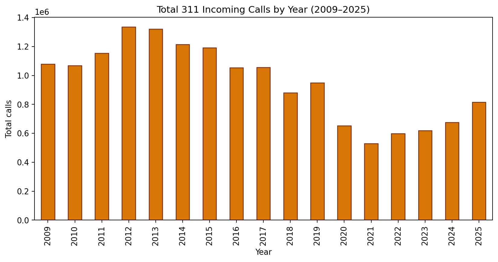

# Winnipeg 311 Call Demand Analysis (2009–2025)

**Was 2025 a sustained surge in Winnipeg 311 demand?**

An exploratory time-series study of daily incoming 311 calls, using the City of
Winnipeg's open dataset. The analysis compares 2025 with 2024 and the longer
2009–2025 record, emphasizing seasonality, weekdays versus weekends, and
short- versus long-term trends.

**Author:** Prince Kanani · University of Manitoba · Winter 2026

## Highlights

| Measure | Result |
|:--|--:|
| Average calls per day, 2024 | 1,844.82 |
| Average calls per day, 2025 | 2,235.04 |
| Change in average daily volume | **+21.15%** |
| Highest-volume full year | 2012 · 1,336,437 calls |
| Lowest-volume full year | 2021 · 530,030 calls |
| Highest-volume calendar month | March 2013 · 130,524 calls |
| Lowest-volume calendar month | October 2021 · 37,906 calls |

The increase was concentrated in several late-spring and summer months.
Weekday volumes remained substantially higher than weekend volumes. These are
**descriptive findings**, not claims of a causal effect or a statistical
significance test.

## Figures



The repository also includes seasonal comparisons, weekday-versus-weekend
figures, rolling averages, and distributional summaries in [`figures/`](figures/).

## Read the paper

- [Research report (PDF)](paper/Winnipeg_311_Call_Demand_2009-2025.pdf)
- [Editable research report (Word)](paper/Winnipeg_311_Call_Demand_2009-2025.docx)
- [Original DATA 2010 course-project PDF (8 pages)](paper/Final_Project_DATA_2010.pdf)

## Reproduce the analysis

Requires Python 3.10 or newer.

```bash
python -m venv .venv
# Windows: .venv\Scripts\activate
# macOS/Linux: source .venv/bin/activate
pip install -r requirements.txt
python scripts/reproduce.py
```

This creates six PNG figures and three CSV summary tables in `outputs/`.
For an interactive explanation, open [`notebooks/winnipeg_311_analysis.ipynb`](notebooks/winnipeg_311_analysis.ipynb).

Tests verify the missing-day imputation and headline report values:

```bash
pip install -r requirements-dev.txt
pytest -q
```

## Repository layout

```text
├── data/          # Archived original CSV
├── notebooks/     # Interactive notebook (local data; no API required)
├── src/           # Data cleaning and summary functions
├── scripts/       # Reproduce figures and tables
├── figures/       # Figures for quick viewing on GitHub
├── paper/         # Final report (PDF and editable Word)
├── tests/         # Data integrity and regression checks
└── docs/          # Dataset license and analysis notes
```

## Methods and limitations

The study uses full years **2009–2025**. The source file also includes partial
2008 and 2026 data, which are excluded from yearly comparisons. One date,
March 9, 2024, is absent in the archived snapshot and is estimated by averaging
its adjacent days. We aggregate daily data to yearly and monthly scales,
compare weekday/weekend averages, and calculate 30- and 90-day rolling means.

The dataset includes total incoming calls only. It does not describe request
categories, waiting time, outcomes, or other possible causes of demand.
Findings should not be interpreted as proof that a particular event or policy
caused the increase, and the descriptive comparisons do not constitute a
formal hypothesis test.

## Data attribution

Data source: [City of Winnipeg Open Data — 311 Incoming Calls by Day](https://data.winnipeg.ca/dataset/311-Incoming-Calls-By-Day/p3xc-y6xi).
Contains information licensed under the
[Open Government Licence – Winnipeg](https://data.winnipeg.ca/stories/s/Open-Data-Licence/rwzh-4ijx/).

This independent project is not affiliated with or endorsed by the City of Winnipeg.
The repository's MIT license applies to project code, **not** to the original dataset or third-party material in the report.